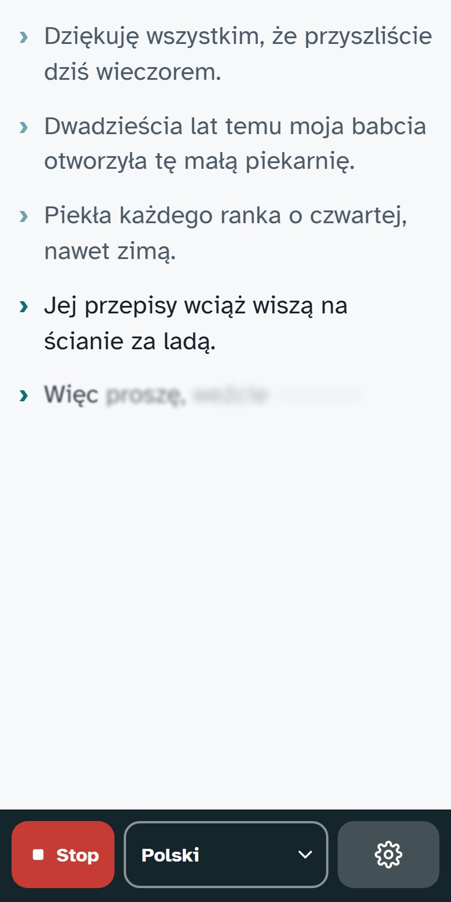
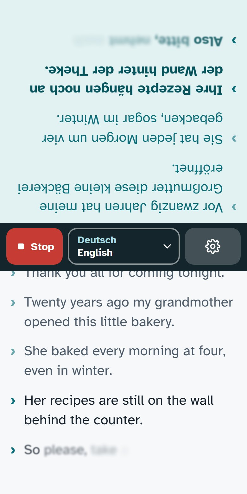
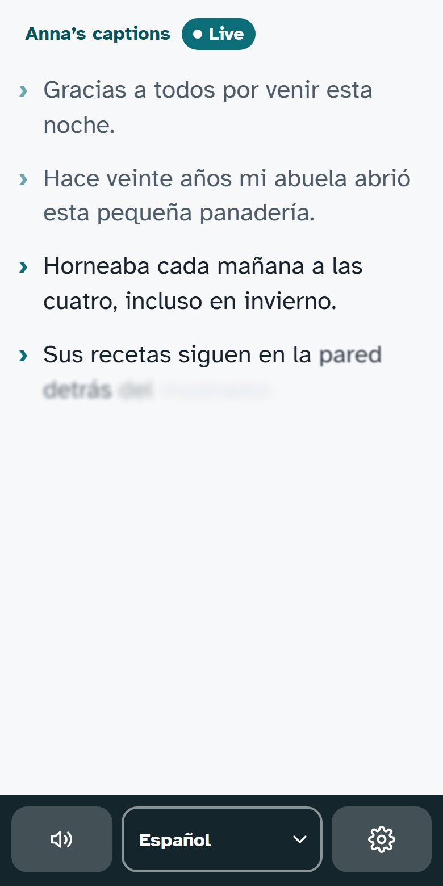
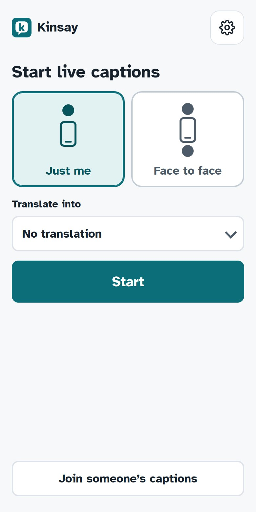
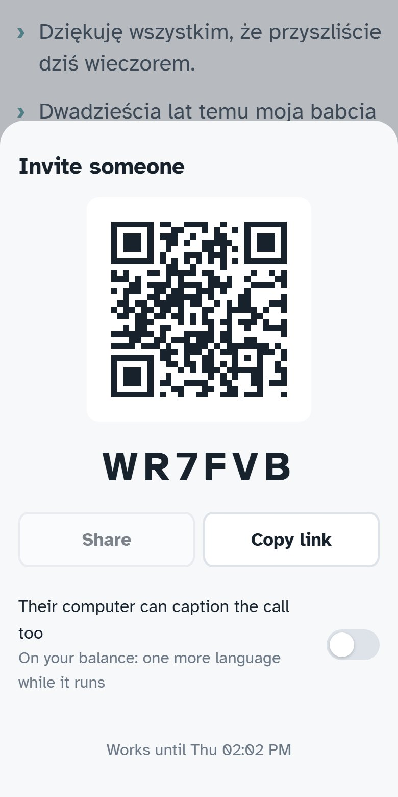
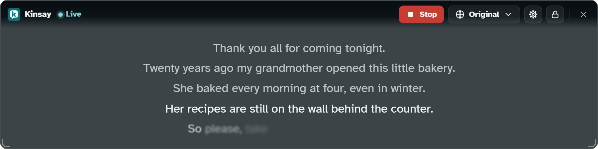
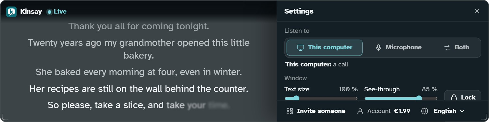
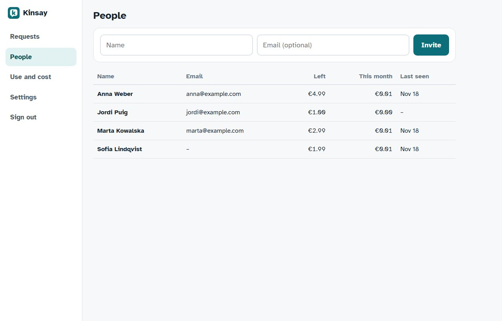

# Kinsay

Live captions with translation, for the moments when people around one table don't
share a language. One phone listens; everyone reads what is said, each in their own
language, a second or two behind the speaker. It works face to face, for a small
audience reading on their own phones, and on a Windows PC as a subtitles window over
a video call.

**Live:** https://translate.dendigital.de. Kinsay is invite-only: anyone can ask for an
invitation on the start page, and credits are granted by hand. The pages are in English,
Polish, Spanish, Catalan and German.

| One person reads                                                              | Face to face                                                                                                   | A reader on their own phone                                                     |
| ----------------------------------------------------------------------------- | -------------------------------------------------------------------------------------------------------------- | ------------------------------------------------------------------------------- |
|  |  |  |

_The speech in these screenshots is made up, and so are the people: they come from the
test server's stand-in for the speech service._

## Background

Kinsay started as the live captions of a wedding app I built for my sister's wedding,
where about 100 guests from Poland, Spain and Germany sit at the same tables. Besides
the captions for the wedding day, that app had grown a captions page for the family's
own use and a subtitles window for Windows. On 12 November 2026 those moved into an app
of their own. The first commit imports what the
wedding app had; everything after it is Kinsay's own history.

The captions engine now lives here, in `packages/engine`, and the wedding app runs an
exact copy of it. A test there refuses an edited copy, so fixes are made in one place.

## What it does

- **Captions in about 60 languages, translated into any of them.** The speech service
  (Soniox) recognises the language as it is spoken, so a conversation can switch
  languages mid-sentence.
- **Three ways to read.** _Just me_ fills the phone with the captions. _Face to face_
  splits the screen: the top half is turned round for the person across the table, in
  their language, and the bottom half is yours. _Readers_ join with a six-character code
  or a QR code and pick their own language; the device can read the lines aloud.
- **A subtitles window for Windows.** A small always-on-top window captions what plays
  on the PC (a call, a video) or what its microphone hears. It can be locked so clicks
  go through it, and it updates itself with signed releases.
  [Download it](https://translate.dendigital.de/download) (Windows 10 and 11).
- **Who said what.** With speakers on, each person gets a colour on the edge of their
  lines.
- **Credits in euros.** Every stream is charged as the audio goes, at a price per hour
  that is a setting. Each person and the whole app have a monthly limit, and a session
  stops by itself at zero credits, after 15 quiet minutes or after 4 hours.
- **Built for older family members.** Every text is 16 px or more, the typeface is
  Atkinson Hyperlegible, the page itself never scrolls (only the captions do), and a
  phone that can't keep its screen on by itself is asked to.

## Screenshots

The start page: who reads, and the language to translate into.



Inviting a reader: a code and a QR code, valid for a day.



The subtitles window on Windows, and its settings drawer beside the captions.





The admin: the people invited, their credits and what they used this month.



## How it works

- **One stream per language.** A session opens one speech stream for each language
  being read (at most three). The host's own stream also gives the words as heard.
  A language nobody reads any more is kept for 10 minutes, then closed.
- **The engine** (`packages/engine`) keeps captions going when the network doesn't:
  audio that can't be sent at once is kept and caught up at twice real time, failed
  streams retry with back-off, a watchdog restarts a stream that hears words but stops
  translating, and long sessions roll over to a fresh stream before the service's limit.
- **Money as integers.** Amounts are kept in micro-euros, and the ledger only ever adds
  rows: grants, use and corrections. A running session's use is one row, brought up to
  date every 10 seconds, so a crash loses at most that much.
- **Sign-in from an invitation list.** The admin gives a device a one-time code
  (six digits or a QR link, valid for 10 minutes). Email links (through Brevo) and
  Google sign-in are offered when their keys are set; both only prove an email that is
  already on the list, and the answer never tells whether an email is invited. A
  device keeps a random secret in its cookie; the database keeps only its hash.
- **Nothing said is stored.** No audio and no transcripts are kept, only how long each
  stream ran. The privacy page (`/privacy`) says what is kept and why.

**Stack:** TypeScript (strict), React 19 and Vite on the client; Fastify 5, Socket.IO 4
and Node 24's built-in SQLite on the server; npm workspaces for the server, the client,
the engine and the shared types. The Windows app is a small C# shell around WebView2.

## Running it locally

You need Node 24 and a Soniox API key for real captions.

```bash
npm install
cp .env.example .env        # set ADMIN_PASSWORD, SESSION_SECRET and SONIOX_API_KEY
npm run dev                 # the client on 5180, the server on 3300
```

Open http://localhost:5180/admin, sign in with the admin password, invite yourself and
make a sign-in code for your device.

## Tests

```bash
npm run check      # format, lint, types and 130 unit and integration tests
npm run test:e2e   # 20 browser tests (Playwright): phones, readers, the admin, the window
npm run test:load  # 200 readers on one session in three languages
```

The browser and load tests run against the real app with a stand-in for the speech
service, so they never reach Soniox or real data.

## Deployment

One Docker container behind Nginx Proxy Manager. A `git push` to a bare repository on
the server runs a hook (`deploy/post-receive`) that builds the image (the build runs
`npm run check`, so a failing test stops the deploy), restarts the container and waits
for its health check. The container is read-only except its database folder, and only
the proxy's own `X-Forwarded-For` is trusted.

## How it was built

Built by Damian Miela; much of the code was written with Claude, Anthropic's AI coding
assistant, under my direction.

## License

All rights reserved. The code is public so you can read it; please ask before reusing
any of it.
